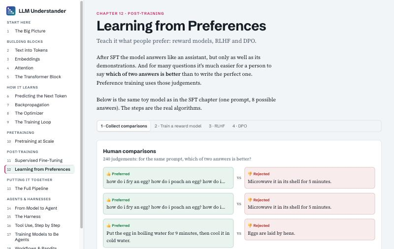
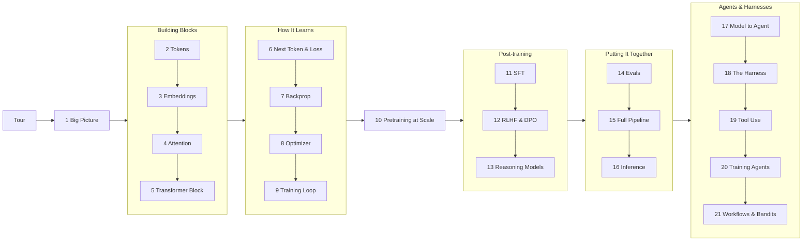

# LLM Understander

A Mac app that teaches how a large language model is trained, from tokens to RLHF and reasoning, and how it becomes an agent inside a harness. It does this with live visualizations driven by a real tiny transformer that trains on your Mac. Start with the Tour: scroll one sentence through the whole chain.

**Also on the web:** the same Tour and 21 chapters as a website that trains the model in your browser — [open LLM Understander on the web](https://amalmehta.github.io/LLMUnderstander/).

| | |
|---|---|
|  |  |
|  |  |
|  |  |
|  |  |
|  |  |

## The 21 chapters

## Links

- [The website](https://amalmehta.github.io/LLMUnderstander/) · [its source](web/)
- [How to set up, run and use it](docs/INSTRUCTIONS.md)
- [What's where in the code](docs/FILE-STRUCTURE.md)
- [How it's designed](docs/SYSTEM-DESIGN.md)
- [Prompt log](docs/PROMPTS.md)
- [All chapter screenshots](docs/screenshots)
- [Project brief](llm%20understander.md)
