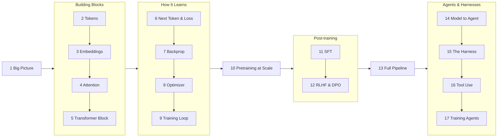

# LLM Understander

A Mac app that teaches how a large language model is trained, from tokens to RLHF, and how it becomes an agent inside a harness. It does this with live visualizations driven by a real tiny transformer that trains on your Mac.

| | |
|---|---|
|  |  |
|  |  |
|  |  |
|  |  |

## The 17 chapters

## Links

- [How to set up, run and use it](docs/INSTRUCTIONS.md)
- [What's where in the code](docs/FILE-STRUCTURE.md)
- [All chapter screenshots](docs/screenshots)
- [Project brief](llm%20understander.md)
