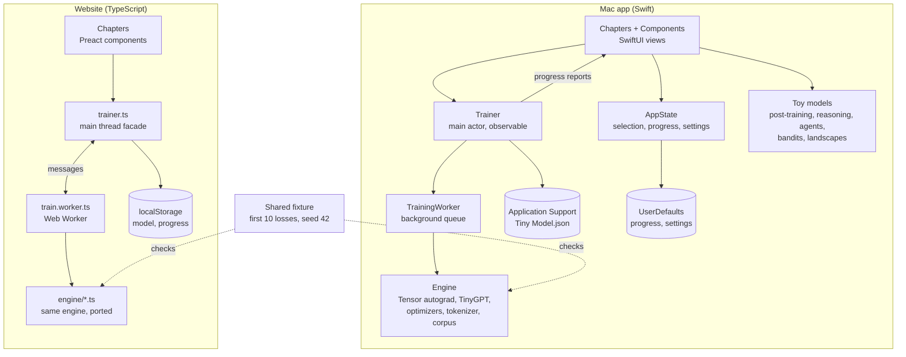

# System Design

LLM Understander is a teaching app: 21 chapters that explain how a language model is trained and turned into an agent, driven by a real tiny transformer that trains on the reader's own machine. It ships twice: a native Mac app (SwiftUI) and a website (Preact + TypeScript) with the same chapters.

## Architecture

## Components

| Piece | Job |
|---|---|
| `Engine/Tensor.swift`, `web/src/engine/tensor.ts` | 2-D tensors with reverse-mode autograd. Swift uses Accelerate BLAS for matrix multiply; TypeScript uses plain loops. Both use 64-bit floats and the SplitMix64 random number generator, so a run with the same seed gives the same numbers. |
| `TinyGPT` / `model.ts` | The transformer: character embeddings, 2 blocks of causal self-attention + MLP, LayerNorm, a `trace` that exposes attention weights and activations for the chapters. |
| `Trainer` + `TrainingWorker` | The training loop. All steps run off the main thread; the UI receives a report every 10 steps and a model snapshot, validation loss, sample and benchmark score every 100. |
| `Corpus`, `Tokenizer` | Generated simple-English sentences (training and held-out validation) and the character tokenizer, plus a real BPE trainer for the tokens chapter. |
| Toy models | Small exact simulations for things the tiny model can't show directly: SFT and preference tuning on an 8-answer policy, GRPO on a thinking-length policy, the agent run and agent RL, bandits, loss landscapes, the scaling law. Each uses the real update maths. |
| `AppState` | The selected chapter, which chapters have been read, the reader's guesses, and the settings shown in the Settings window. |
| Chapters | One view per chapter, built from shared parts in `UI/Components.swift` (cards, heatmaps, probability bars, the guess card, the model status banner). |

## Main flows

1. **Train.** Chapter 9 starts the worker. Each step: take a batch, forward pass, cross-entropy loss, backward pass, gradient clipping, AdamW update with warm-up and cosine decay. Every 100 steps the worker sends a frozen copy of the model to the main actor. Chapters 3–7, 10, 11, 14 and 16 and the Tour look inside that copy, so they always show the reader's own model.
2. **Save and resume.** When training stops, the weights, optimizer state and chart history are saved. On launch they are restored if the model shape matches.
3. **Read.** A chapter counts as read after 20 seconds open or when scrolled to its end. The sidebar shows a tick and the app reopens on the last chapter.
4. **Guess.** One card per chapter asks what the reader expects before a live demo. The answer stays hidden until they pick or run it.

## Where data lives

Everything stays on the reader's machine. Nothing is sent anywhere, and there is no account.

| Data | Mac | Website |
|---|---|---|
| Trained model, optimizer state, charts | `~/Library/Application Support/LLM Understander/Tiny Model.json` | `localStorage` |
| Chapters read, guesses, settings | `UserDefaults` | `localStorage` |

Settings has buttons to reset the model and the reading progress. The feedback tab opens a pre-filled GitHub issue in the browser, and the reader sees and sends it themselves.

## Threat model

There's no server, no sign-in and no personal data, so the attack surface is small:
- **Saved files:** a tampered `Tiny Model.json` can only change weights. It is decoded as plain numbers and rejected if its shape doesn't match.
- **Feedback:** the issue text is built from what the reader types and opened as a URL; nothing is sent until they press Submit on GitHub.
- **Distribution:** the Mac app is signed with a Developer ID and notarized, so macOS checks it hasn't been changed. The website is a static page on GitHub Pages with no third-party scripts.
- **Secrets:** none in the repo. Notarization credentials live in the release machine's keychain.

## Key decisions and trade-offs

- **A real model, kept tiny.** About 28k weights, so a full run takes about a minute on a laptop and learning is visible. The cost is that it can only write simple sentences; post-training and reasoning use toy models instead, labelled as such.
- **No ML framework.** The autograd engine is written by hand in both languages so every chapter can look inside it. The cost is two engines to keep in step; the shared fixture test catches drift.
- **Same random numbers on both platforms.** Both use SplitMix64 with the same seeds, so the website and the Mac app show the same run.
- **Web Worker for training on the website.** Training used to run in short slices on the main thread because the first host (an Artifact page) didn't allow workers. On GitHub Pages it moves to a worker so scrolling stays smooth.
- **Counted, not timed.** The KV cache and speculative decoding are shown with exact counts and published formulas rather than wall-clock timings, which would be noisy on a model this small.

## How it's tested

- `Tests/EngineTests.swift`: gradient checks for every op, optimizer behaviour, that training lowers loss, the post-training, GRPO and bandit toys, and the shared fixture.
- `UITests/AppUITests.swift`: launches the app and clicks through every chapter.
- `web/tests/*.test.ts` (Vitest): the same engine and toy checks, the shared fixture, and the worker protocol.
- CI (`.github/workflows/ci.yml`) runs the website tests and type check and the Swift engine tests on every push and pull request. The website deploys only after its tests pass.

## Known limits, and what would change at scale

- The model is character-level with a 32-character context. A word-level or BPE model would need a bigger context and a minute-plus becomes many minutes; the trainer's report interval and the saved file format would need to change.
- The saved model is JSON (about 0.6 MB). At a million weights it should become a binary file.
- The website keeps everything in `localStorage` (about 5 MB limit). A bigger model would need IndexedDB.
- Nothing is shared between readers. Classrooms or shared progress would need accounts and a server, which this design deliberately doesn't have.
